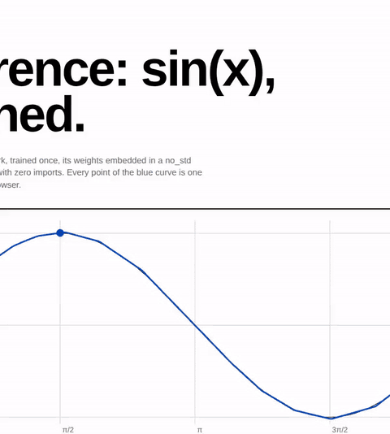
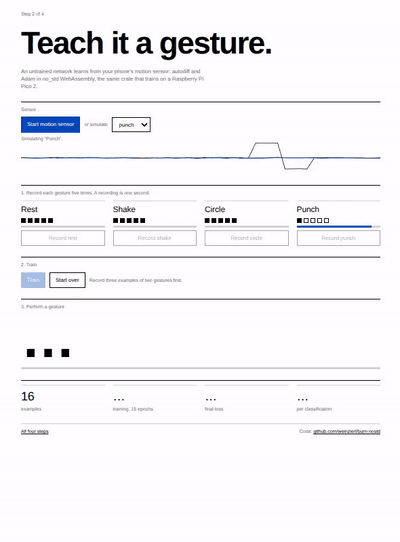
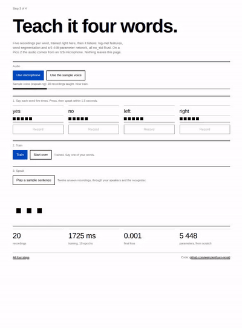
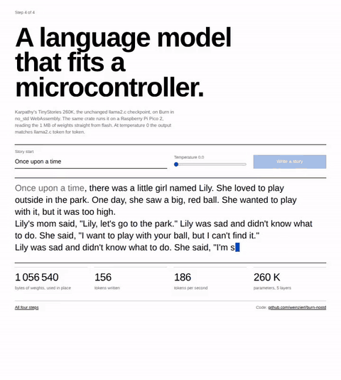

# Burn without std

Machine learning in four steps, each one `#![no_std]` Rust on
[Burn](https://burn.dev) 0.22, each one running on the desktop, in the browser
and on an emulated Cortex-M33 (QEMU), and built as Raspberry Pi Pico 2
firmware (not yet tested on a board).

**Try it in the browser: [weinzierl.github.io/burn-nostd](https://weinzierl.github.io/burn-nostd/)**

| Step | Shows | Desktop | Browser | Pico 2 (not yet run) |
|---|---|---|---|---|
| [1 · sine](1-sine) | inference with embedded weights | `cargo sine` | [demo](https://weinzierl.github.io/burn-nostd/sine.html) | LED breathes with the model |
| [2 · gesture](2-gesture) | training on the device | `cargo gesture` | [demo](https://weinzierl.github.io/burn-nostd/gesture.html) | learns gestures from an IMU |
| [3 · keywords](3-keywords) | real signals: audio | `cargo keywords` | [demo](https://weinzierl.github.io/burn-nostd/keywords.html) | learns words from a microphone |
| [4 · tinystories](4-tinystories) | a pretrained language model | `cargo tinystories` | [demo](https://weinzierl.github.io/burn-nostd/tinystories.html) | writes stories from flash |

| 1 · sine | 2 · gesture | 3 · keywords | 4 · tinystories |
|---|---|---|---|
|  |  |  |  |

## Desktop

With [rustup](https://rustup.rs) installed, the right toolchain comes from
`rust-toolchain.toml`:

```sh
cargo sine                 # step 1; `cargo sine-train` retrains its weights
cargo gesture              # step 2, with synthetic IMU data
cargo keywords             # step 3, with bundled recordings
cargo keywords -- --enroll yes a.wav b.wav --enroll no c.wav d.wav --listen e.wav f.wav
cargo tinystories -- "Once upon a time" 0.8
cargo test --release       # checks all four, step 4 against llama2.c
```

Recordings for `cargo keywords`: 16-bit WAV, any sample rate, one word per
enrollment file. Record your own (`arecord -d 2 -r 16000 -c 1 -f S16_LE yes1.wav`
on Linux, `ffmpeg -f avfoundation -i :0 -t 2 yes1.wav` on macOS) or take
real voices from Google's [Speech Commands](https://www.tensorflow.org/datasets/catalog/speech_commands)
(CC BY 4.0); its 182 MB subset [mini_speech_commands.zip](http://storage.googleapis.com/download.tensorflow.org/data/mini_speech_commands.zip)
has folders `yes`, `no`, `left`, `right`. Five recordings of one voice work
best; different speakers need more.

The desktop programs are `no_std` too: [desktop/src/lib.rs](desktop/src/lib.rs)
provides what std would (allocator, output, files, clock) from libc.

## Browser

```sh
cargo web                  # builds the four modules, serves http://localhost:8000
cargo web --out site       # or writes a static copy for any web server
```

The modules are `no_std` WebAssembly with zero imports and no wasm-bindgen.
`cargo web` itself is a small std tool in [serve](serve/src/main.rs).

## Raspberry Pi Pico 2

The firmware builds; it has not been run on a board yet. Steps 1 and 4 need only the board. Step 2 adds an LSM6DSOX IMU breakout and
step 3 an SPH0645 I2S microphone breakout, each with a push button:

| Part | Pico 2 pins |
|---|---|
| LSM6DSOX (I2C) | GP4 SDA, GP5 SCL, 3V3, GND |
| SPH0645 (I2S) | GP18 BCLK, GP19 LRCL, GP20 DOUT, SEL to GND, 3V3, GND |
| Button | GP15 to GND |

```sh
cd pico2
cargo run --release --bin sine     # also gesture, keywords, tinystories
```

`cargo run` flashes and shows the log through a debug probe with
[probe-rs](https://probe.rs). Without a probe, see `pico2/.cargo/config.toml`.

No probe at all? `tinystories-usb` writes the stories to the board's own USB
port, as a serial device, and touches no pins, so it is meant for any RP2350
board with USB (also not yet run on one). Make a UF2 file, hold BOOTSEL (on
some boards: BOOT) while resetting, and copy the file to the drive that appears:

```sh
cd pico2
cargo build --release --bin tinystories-usb
python3 uf2.py target/thumbv8m.main-none-eabihf/release/tinystories-usb tinystories-usb.uf2
```

Then open the port in a terminal: `screen /dev/cu.usbmodem*` on macOS,
`screen /dev/ttyACM0` on Linux. The official converter is
`picotool uf2 convert <elf> <uf2> --family rp2350-arm-s`.

`tinystories-lcd` is the same for the Waveshare RP2350-Touch-LCD-3.5, with
the stories also on its 480 x 320 screen from power-up (pins and panel setup
from Waveshare's example code). Build and flash it the same way.

No board? The same code runs on an emulated Cortex-M33 with the same memory
budget (needs `qemu-system-arm`):

```sh
cd qemu
cargo run --release --bin tinystories   # also sine, gesture, keywords
```

`cargo run --release --bin tinystories-usb` there prints, word for word, the
first four stories the USB firmware should write.

## What it took

* Burn's core crates build without std, but a no_std *binary* on a desktop or in
  the browser still pulls in std through `web-time` and
  `wasm-bindgen-futures`: two small [shims](shims) replace them.
* `burn-optim` needs std, so steps 2 and 3 use an 80-line [Adam](adam/src/lib.rs).
* Without std on Arm, gemm allocates a 512 KiB packing buffer for each small
  matrix-matrix product, twice the 256 KiB heap. Training with batch size 1
  and decoding one token at a time keep every product a matrix-vector
  product, which needs none.
* Step 4 never copies its weights: tensors borrow the checkpoint in flash,
  so a 1 MB model runs with a heap peak of 180 KiB (measured in QEMU).

## Layout

```
1-sine/ 2-gesture/ 3-keywords/ 4-tinystories/   the four steps, no_std libraries
adam/          Adam optimizer without std
desktop/       the steps as no_std desktop programs
web/           the steps as WebAssembly, and the demo site
pico2/         the steps as Raspberry Pi Pico 2 firmware
qemu/          the firmware's code paths on an emulated Cortex-M33
serve/         `cargo web`: builds and serves the browser demos (std)
shims/         stand-ins that keep std out
```

## Credits

TinyStories 260K and its tokenizer are by Andrej Karpathy
([llama2.c](https://github.com/karpathy/llama2.c), MIT). Code: MIT or Apache-2.0.
